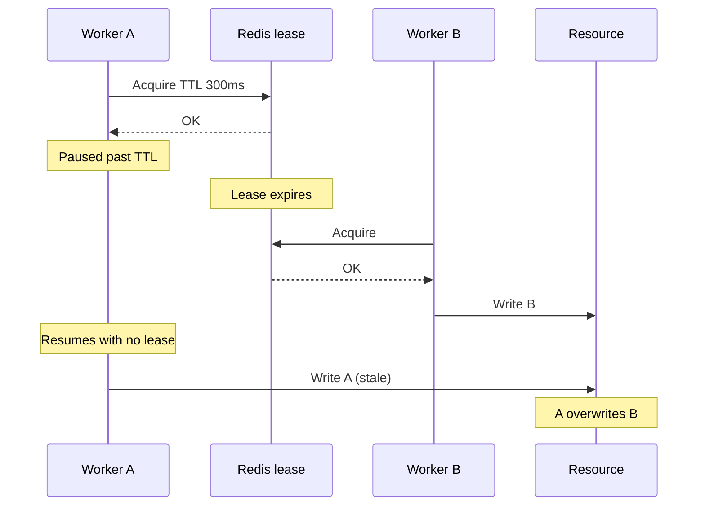

# Redis Fencing Tokens — Go + Redis

**A reproducible example of why an expired Redis lease is not sufficient to protect correctness-critical writes.**

This experiment simulates two workers. Worker A acquires a 300 ms lock and pauses; its lease expires, so B acquires the lock and writes. A then resumes and overwrites B in the deliberately unsafe version. A second run uses resource-enforced fencing tokens to reject A's stale write.

> Educational experiment: single Redis primary, no failover simulation, and a minimal custom RESP2 client. Do not use this implementation in production or against a shared Redis instance.

## Why I explored this

Working with Redis-based coordination, retries, and distributed workflows raised a question for me: **if a worker acquires a distributed lock, is its subsequent write necessarily safe?** This example explores a worker that *used* to hold a valid lease but keeps operating after expiry. It is an isolated learning exercise, not a description of a specific production incident.

## Run

Requires Go 1.23+, Docker, Docker Compose, and an unused local port 6379.

```bash
cd redis-fencing-tokens
docker compose up -d
go test ./...
go vet ./...
go run .
docker compose down
```

You may set `REDIS_ADDR=host:port` to use another **disposable** instance. Only the `fencing-demo:*` keys are reset. The teaching client does not support authentication or TLS.

## Unsafe lease-expiration scenario



## Fencing-token scenario

```mermaid
sequenceDiagram
    participant A as Worker A
    participant R as Redis lease + token allocator
    participant B as Worker B
    participant S as Resource (atomic token check)
    A->>R: Acquire
    R-->>A: token=1
    Note over A: Paused past TTL
    B->>R: Acquire
    R-->>B: token=2
    B->>S: Write B (token 2)
    S-->>B: ACCEPT; last_token=2
    A->>S: Write A (token 1)
    S-->>A: REJECT; 1 < 2
    Note over S: Final value remains B
```

The key is **atomic enforcement by the authoritative resource**, not a token check on the worker side followed by an unguarded write.

## Expected output

The following is illustrative until the Redis-backed GitHub Actions job confirms the run:

```text
=== WITHOUT FENCING ===
A acquired 300ms Redis lease; simulated work pauses
Lease expired; B acquired the same lock
B wrote: newer-write-from-B
A resumed and overwrote B, despite expired lease
Final value: stale-write-from-A  <-- WRONG
A's attempted unlock removed B's lock: false (must be false)

=== WITH RESOURCE-ENFORCED FENCING ===
A acquired lease, token=1; simulated work pauses
Lease expired; B acquired lease, token=2
Resource accepted B's newer write
Resource accepted A's stale write: false (must be false)
Final value: newer-write-from-B  <-- CORRECT
Last accepted token: 2
```

## Correctness boundaries

- `INCR` on a single Redis primary is not a durable, failover-proof fencing-token allocator. Some acknowledged increments could be lost on failover.
- The destination must compare the token and update its state **atomically**. A Redis check followed by an unguarded database or external API write is not equivalent.
- Fencing only rejects older tokens **after a newer token has been accepted at the resource**. It does not necessarily reject all writes by expired lease-holders immediately.
- The sample allows repeated writes using the *same token* (`token < last_token`), so it is not an idempotency mechanism.
- Safe owner-checked unlock prevents deleting another worker's lock, but does not stop the stale-write problem.
- For authoritative transactional database state, row locks or optimistic concurrency may be more appropriate than a separate Redis lease.

## Files

- [`main.go`](main.go): lease-expiration simulation, Lua scripts and two scenarios
- [`redis.go`](redis.go): minimal RESP2 client for this lab, not production
- [`redis_test.go`](redis_test.go): protocol unit tests
- [`compose.yaml`](compose.yaml): isolated local Redis
- [`diagrams/`](diagrams/): Mermaid source diagrams (editable)
- [GitHub Actions](../.github/workflows/redis-fencing-tokens.yml): runs tests and both scenarios with Redis

## Further reading

- [Martin Kleppmann — How to do distributed locking](https://martin.kleppmann.com/2016/02/08/how-to-do-distributed-locking.html)
- [Redis — Distributed Locks](https://redis.io/docs/latest/develop/clients/patterns/distributed-locks/)
- [Redis — Persistence](https://redis.io/docs/latest/management/persistence/)
